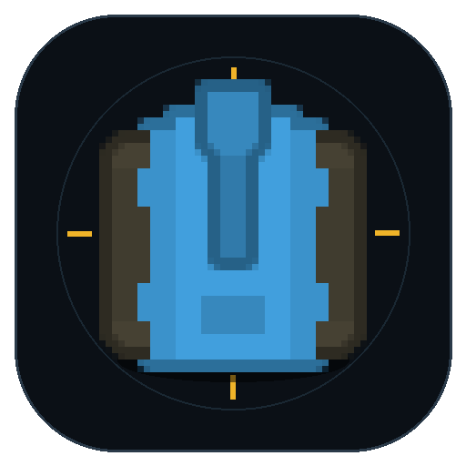

<p align="center">
  
</p>

# Steel Tide · 钢铁潮汐

基于 Kenney《Top-Down Tanks Redux》素材的双关卡坦克生存游戏，Vite + Phaser 3，桌面 / 手机 / 手柄可玩。

## 运行

```bash
npm install
npm run dev
```

默认地址 http://localhost:5173/

## 关卡

**第一关 · 新兵训练**：草地训练场，依次完成移动 → 击毁 3 辆靶车 → 击毁 3 辆训练坦克 → 拾取维修补给。训练模式不会真正阵亡，完成后解锁第二关。

**第二关 · 生存极限**：35×25 沙漠竞技场，敌人持续增援，波次每 18 秒增强；约 75 秒出现泰坦，之后约每分钟一只。击杀、精英和定时空投会掉落三连发、速射、穿甲、维修、护盾、清场、超载等补给。**生存时间就是得分**，历史最佳保存在 localStorage。

## 操作

| 设备 | 操作 |
| --- | --- |
| 桌面 | WASD / 方向键移动，鼠标瞄准，左键 / 空格开火，M 静音，Esc 暂停，F 全屏 |
| 手机 | 左半屏摇杆移动，右半屏摇杆瞄准并开火 |
| 手柄（标准映射） | 左摇杆 / 十字键移动，右摇杆瞄准，RT/R2 或 RB/R1 开火，Start 暂停 |

菜单、结算、暂停界面可用方向键 / 十字键 / 左摇杆选择，Enter / A 确认，Esc / B 返回。手柄支持震动反馈；未连接时自动回退键鼠 / 触摸。非标准映射手柄可能需要在系统或浏览器层重映射。

主菜单和结算界面右上角提供 GitHub 源码入口与全屏按钮；暂停界面也可以切换全屏。不支持元素全屏的浏览器（如 iPhone Safari）会自动隐藏全屏按钮。

部分浏览器首次用手柄操作可能没有声音，按一次键盘或点击屏幕即可恢复。

## 素材与字体

- 美术：Kenney《Top-Down Tanks Redux》，CC0，见 `License.txt`，已收录到 `public/assets/`。
- 标题字体：Fusion Pixel Font 12px Proportional (zh-Hans)，SIL OFL 1.1，项目内仅保留约 22KB 字符子集，许可见 `public/assets/fonts/OFL-FusionPixel.txt`。

## 调试

浏览器控制台可通过 `window.__game` 访问游戏实例。
